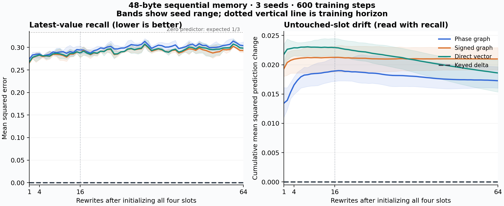

# PhaseGraphFastWeightCell

An experimental PyTorch recurrent cell whose persistent inference state is
**one uint8 phase per graph edge and channel**. A learned writer changes
the edge phases; each read injects a fresh spatial query into the graph.
There is no retained observation history or floating hidden-state cache.

This extracts the phase-only idea from [GraphNN](https://github.com/anttiluode/GraphNN)
into a vector/sequence interface and adds circular quantization, a provably
non-amplifying graph read, streaming masks, and a harder sequential test.
It is a working research implementation. **Its accuracy and comparative
value must be judged from the new benchmark, not inherited from GraphNN's
two-image result.**

**First measured outcome: no phase advantage.** Three seeds, 600 training
steps per model, 384 held-out continuous-value streams, 48 state bytes:

| Memory | MSE after 16 rewrites ↓ | MSE after 64 rewrites ↓ |
| --- | ---: | ---: |
| Phase graph | 0.294348 | 0.303904 |
| Signed graph | 0.287949 | 0.293045 |
| Direct vector | 0.287519 | 0.298433 |
| Orthogonal-key delta | 0 | 0 |

**All predeclared phase gates failed.** The learned arms only weakly
recover the latest values at this training budget; lower phase drift is
not evidence of better retention when recall itself is poor. This does
not refute GraphNN's narrower image result, nor prove longer training
cannot improve this cell. It does rule out claiming this build has
already delivered Gemini's proposed general memory advantage.



[Full results and interpretation](results/sequential_v1/REPORT.md) ·
[Exact scores](results/sequential_v1/summary.json)

## Gate 2: error-driven writes and the horizon trap (October 14)

The original learned 48-byte phase/signed/vector models failed long-horizon key-value recall, and the phase cell was trained only to 16 rewrites before its 64-rewrite test. Gate 2 tests three separate possibilities without changing the original PR #1 code or results:

- **Generic sparse adjoint phase writer**: wraps a frozen phase graph reader and computes `J(query,state)^T (prediction-target)` using PyTorch autograd. A discrete backtracking line search changes at most `topk × iterations` phase bytes and penalizes changes to other readouts. This is a *slower*, error-driven online optimization, not a fused fast-weight RNN or a trained new reader. A repeated input is a no-op only if the current prediction is accurate enough.
- **Indexed plaquette-delta positive control**: uses exact known keys and local closed-loop phase measurements. After 64 rewrites it obtains **0.0000202 MSE**, **0% sham-write byte changes**, and **0 unintended readout drift**, for both a 72-byte and an 896-byte graph. It is equivalent to an indexed quantized table: only 12 scalar bytes carry user data. The 48-byte float32 exact-key delta baseline remains better (**0 MSE**). This proves local phase updates *can* survive many rewrites, not that a learned graph has figured out how to do so.
- **Horizon-matched learned training**: a new truncated-BPTT training runner samples histories of 1,4,16,64 rewrites and trains the original phase, signed, and vector architectures with intermediate losses. It lets us test whether the original negative result came from extrapolating 16→64. No full-budget performance claim is made until those runs are finished and evaluated.

On a tiny **two-stream-per-seed**, four-rewrite frozen-reader diagnostic, the generic adjoint wrapper produced mixed outcomes (PR1 final MSE → adjoint: seed 41 **0.2780→0.2848**, seed 97 **0.3633→0.3637**, seed 127 **0.3155→0.3105**). Thus it **has not fixed** the originally weak learned readout.

[Full Gate 2 analysis](results/local_delta_v2/REPORT.md) · [three-seed measured receipts](results/local_delta_v2/pilot.json) · [successful 64-rewrite workflow](https://github.com/anttiluode/PhaseGraphFastWeightCell/actions/runs/38595055296)

```bash
python -m pytest -q
python -m phasegraph.local_delta_benchmark --seeds 41 97 127 --output runs/local_delta/summary.json
python -m phasegraph.horizon_train --steps 600 --seeds 41 97 127 --train-horizons 1 4 16 64 --segment 8 --output runs/horizon_matched
```

A 4×4 lattice with two channels already contains 18 face cycles; merely increasing state from 48 to 896 bytes does not prove those cycles store useful memories. The original 85% sham-rewrite statistic was measured in a **different model, GraphNN**, not in this cell. The next actual learned test must train a reader that supports selective error-driven writes over many steps, under matched key access, state bytes, parameter counts and probe compute.

## Install and run

Python 3.10+ and PyTorch 2.5+; CPU is verified. CUDA is selectable with a
compatible PyTorch installation but was not tested in the recorded run.
No models or datasets need downloading.

```bash
git clone https://github.com/anttiluode/PhaseGraphFastWeightCell.git
cd PhaseGraphFastWeightCell
python -m pip install -e ".[test]"
python -m pytest -q
python examples/streaming_demo.py
```

On Windows, use your installed Python command in place of `python` if
necessary. The example loads a bundled checkpoint, updates one of four
continuous-valued slots at a time, and reports reconstruction error and
drift of the slots it did not update. It also runs an exact keyed
delta-rule control. The example performs frozen inference, without fitting
the new observations into shared weights.

## Use as a recurrent cell

```python
import torch
from phasegraph import PhaseGraphFastWeightCell, PhaseGraphRNN

# 4 slot-key features + 3 observed values; output a queried 3-vector.
cell = PhaseGraphFastWeightCell(7, 3, query_size=4).eval()
state = cell.initial_state(batch_size=2)       # [2, 2, 24], actual uint8
observation = torch.randn(2, 7)
query = torch.eye(4)[:2]

with torch.inference_mode():
    answer, state = cell(observation, state, query=query)
    answer_again = cell.read(state, query)    # no observations needed

assert state.dtype == torch.uint8
assert cell.state_bytes() == 48               # per stream; weights extra

# Batch-first sequences, explicit state threading and chunking:
rnn = PhaseGraphRNN(cell)
x, queries = torch.randn(2, 10, 7), torch.randn(2, 10, 4)
with torch.inference_mode():
    answers, state = rnn(x, queries=queries)
```

For a sequence mixer's usual `[batch, time, d_model]` interface:

```python
mixer = PhaseGraphRNN(PhaseGraphFastWeightCell(64, 64))
hidden = torch.randn(2, 8, 64)
mixed, state = mixer(hidden)       # implicit query = current token
residual = hidden + mixed
residual.square().mean().backward()
```

Training uses byte-rounded floating state with a straight-through gradient
at **every write**. Call `.train()` for backpropagation through time and
`.eval()` for packed byte state; `.eval()` does not itself disable autograd.
Use `torch.inference_mode()` for inference. Packing explicitly detaches
the state, so do not pack between training steps that need BPTT.

`write_mask` and `reset_mask` are boolean `[batch]` for a cell and
`[batch,time]` for the wrapper. Reset occurs first; a false write mask then
preserves the reset/previous state. Reads never mutate state. Separate
queries are required when `query_size != input_size`. Input/query floats
must match model dtype/device; this version supports float32 and float64,
not automatic mixed precision or fused scan kernels.

## What is bounded

- **Stored state:** exactly `channels * 2 * grid_size * (grid_size - 1)`
  bytes per stream, independent of sequence length. Defaults: **48 B**;
  `grid_size=8, channels=8`: **896 B**.
- **Transported query norm:** symmetric degree normalization makes each
  graph hop a Euclidean-norm contraction. This property comes from the
  transport rule, not from storing phases alone.
- **Not covered by these bounds:** shared model weights, training
  activations/gradients, unpacked floating and complex temporaries, decoder
  output magnitude, or task accuracy. Parameter and buffer bytes are
  reported separately.

Every phase byte is `2π * b / 256`, with no duplicate endpoint. Updates
wrap around the circle. Forward/reverse edges are complex conjugates;
the transport is Hermitian and dissipative, **not unitary**. Query angles
do not create automatic protected addresses. The query projection learns
a spatial excitation and retention has to be measured.

See [the equations and integration limits](docs/MECHANISM.md).

## Reproduce the sequential test

```bash
python -m phasegraph.benchmark --steps 600 --seeds 41 97 127 --output runs/reproduction
```

To regenerate the figure, install the optional plotting dependency with
`python -m pip install -e ".[plots]"`, then run
`python scripts/plot_results.py runs/reproduction`.

This learns latest-value recall for four independently updated slots,
each containing three real numbers. An input contains the changed key
and its new value only. After four initializing writes, training uses
1–16 random rewrites. Frozen evaluation uses 1, 4, 16 and 64 rewrites;
the reader gets state and a key, never the targets or missing values.
Each seed has 128 independent held-out streams.

The three learned arms have equal parameter counts, state bytes,
initialization seeds, training batches, step counts and Adam settings:

| Arm | State interpretation | Read operation |
| --- | --- | --- |
| Phase | circular edge phase | complex normalized graph transport |
| Signed | interval-quantized edge weight in [-1,1] | real normalized graph transport |
| Vector | interval-quantized scalar code | query plus direct byte features |
| Analytic delta | float32 key/value matrix, also 48 B here | exact orthogonal-key retrieval |

All learned writers see the same sine/cosine features of byte codes. The
phase arm wraps updates; signed/vector updates clip to the interval.
The analytic delta control has prescribed orthogonal keys and no learned
parameters. It is a strong positive control for this explicitly keyed task;
it is not a trained language-model baseline. Equal bytes/parameters do not
mean equal read compute.

Frozen thresholds are MSE ≤0.05 after 16 updates and ≤0.10 after 64, in
every seed. A superiority claim additionally requires beating both learned
controls at both horizons in every seed. These thresholds are reported
even when they fail. Shuffled-state, blank-state and skipped-update
controls accompany error and untouched-slot drift. A constant reader can
have zero drift, so drift alone is not evidence of retention.

Recorded results, checkpoint weights, environment, source hashes and
seed-level scores live in [results/sequential_v1](results/sequential_v1).
The [report](results/sequential_v1/REPORT.md) records the actual outcome.

## Relationship to Mamba and fast weights

The cell can replace the **interface** of a recurrent sequence mixer in
a model that is trained around it. It cannot replace an existing
pretrained Mamba state tensor while retaining the old weights. No
Mamba/Transformer language model is trained or benchmarked here.

Mamba uses selective state-space dynamics, not an unconditionally additive
`D × D` memory; delta-rule models already address overwrite through
error-correcting updates. This package compares with an explicit delta
control rather than assuming conventional recurrent state must explode.
Primary references: [Mamba](https://arxiv.org/abs/2312.00752),
[Gated DeltaNet](https://arxiv.org/abs/2412.06464).

The reference implementation unpacks bytes for floating/complex compute.
It includes Python loops and validation synchronizations. Compact storage
does **not** demonstrate faster hardware execution, better gradients,
general continual learning, or a new associative-memory principle.

MIT. GraphNN provenance: [`0e3d4ca`](https://github.com/anttiluode/GraphNN/commit/0e3d4ca441aa6a549c5f596dc113eff79a8d21d8).
